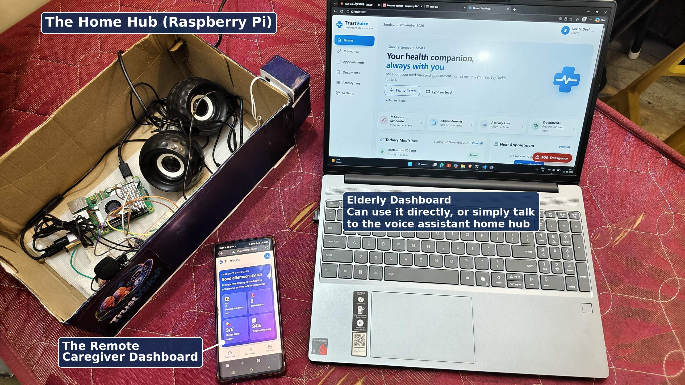
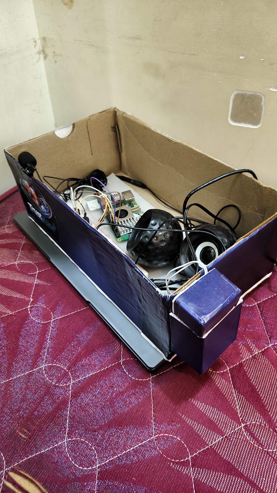
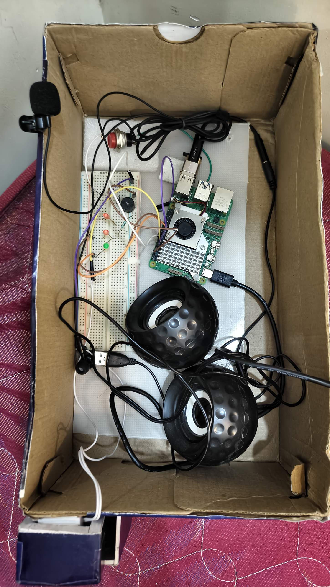
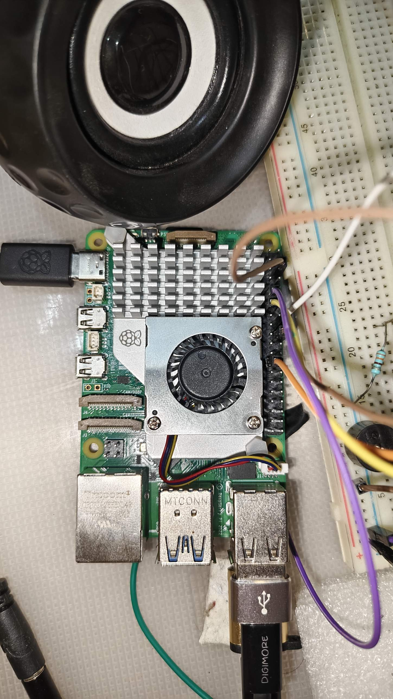
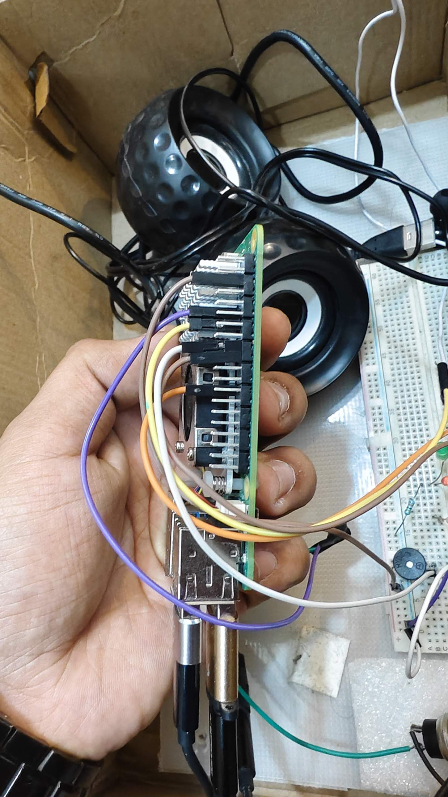
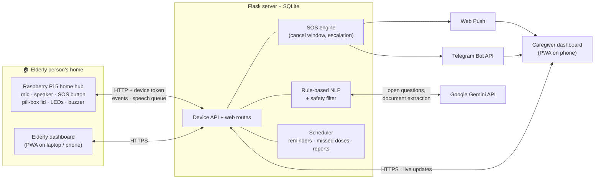

# TrustVoice

**A voice-first health companion for elderly people living alone, with remote monitoring for the family who cares for them.**


> [!NOTE]
> **This repository is a project overview only. It contains no source code.**
> The full source code (Flask server, web app and Raspberry Pi hub) is in a private repository:
> **[marvelayush/trustvoice](https://github.com/marvelayush/trustvoice)** 🔒
>
> The link works only if you have been given access. To request access, email
> **[ayushnarayan870@gmail.com](mailto:ayushnarayan870@gmail.com?subject=TrustVoice%20source%20code%20access%20request)**
> with your name, your GitHub username and why you need it.

## 🎥 Demo Video

▶️ **[Watch the full project walkthrough (Google Drive)](https://drive.google.com/file/d/1coaFZr7Jk_Ncedf3VAKRk5MD0Pn2i7KZ/view?usp=drivesdk)**

<p align="center">
  
</p>

## 🧩 How the three parts work together

### 1. The Home Hub (Raspberry Pi 5)

The hub stays near the elderly person at home. They just say **"hello"** and ask things like *"what are my medicines today?"*. The hub listens for the wake word offline (Vosk), understands the question, and answers through its speaker.

- **Reminders:** when a dose is due, it beeps and speaks the reminder.
- **Pill box:** opening the pill-box lid (a reed switch) marks the dose as taken.
- **SOS:** pressing the red SOS button raises an emergency, with a **10-second cancel window** for accidental presses.
- **Offline:** it keeps working without internet and sends its queued events when the server is reachable again.

### 2. The Elderly Dashboard (web app on a laptop or phone)

For elderly users who are comfortable with a screen. Large buttons lead to today's medicines, appointments, documents and the activity log, and there is always an **SOS Emergency** button. **"Tap to listen"** gives the same voice assistant in the browser. Anyone who can't or doesn't want to use a screen talks to the home hub instead. Both stay in sync.

### 3. The Remote Caregiver Dashboard (on a son's or daughter's phone)

This shows the people they care for, doses taken today, open alerts and 7-day adherence, all updated live. Caregivers:

- get SOS alerts on the dashboard, by **Web Push** and on **Telegram** (with a voice clip and live location), and can acknowledge them;
- can send a message that the hub reads aloud;
- can view the weekly report.

### Example flow

1. Dose time arrives.
2. The hub beeps and speaks: *"Time to take Metformin 500 mg, 1 tablet."*
3. The elderly person opens the pill box.
4. The dose is marked as taken.
5. The "doses taken today" count on the caregiver's dashboard goes up by one.

<table>
  <tr>
    <td align="center" width="50%">
      <br>
      <sub>The home hub enclosure: microphone on the side, pill box attached on the right</sub>
    </td>
    <td align="center" width="50%">
      <br>
      <sub>Inside the hub: Raspberry Pi 5, breadboard with SOS button, LEDs and buzzer, speakers, mic</sub>
    </td>
  </tr>
  <tr>
    <td align="center" width="50%">
      <br>
      <sub>Raspberry Pi 5 with active cooler and GPIO wiring</sub>
    </td>
    <td align="center" width="50%">
      <br>
      <sub>GPIO header wiring (side view)</sub>
    </td>
  </tr>
</table>

---

## 📑 Table of contents

- [Demo video](#-demo-video)
- [Problem statement](#-problem-statement)
- [Features](#-features)
- [Architecture](#-architecture)
- [Hardware](#-hardware)
- [Tech stack](#-tech-stack)
- [Results](#-results)
- [Project structure](#-project-structure)
- [Source code access](#-source-code-access)
- [Future enhancements](#-future-enhancements)
- [Team](#-team)

## 🎯 Problem statement

Elderly people who live alone must manage several medicines a day, keep track of appointments and test results, and get help quickly in an emergency, often with reduced eyesight, hearing, memory or dexterity. Existing digital tools are screen-heavy, general-purpose, or disconnected from the family members who care for them, and AI assistants can give unsafe medical answers.

TrustVoice is a low-cost, voice-first assistant that:

- helps an elderly person follow their medicine and appointment schedule;
- detects and escalates emergencies reliably while limiting false alarms;
- keeps remote caregivers informed in real time;
- reduces manual data entry by reading prescriptions;
- stays safe and usable when AI services or the internet are unavailable.

## ✨ Features

### Voice assistant
- Wake word **"hello"** (or "hey TrustVoice"), then natural questions about medicines, doses and appointments.
- Follow-up questions without repeating the wake word, and **barge-in**: say "hello" while it is talking to interrupt.
- Commands mixed with Hindi or Kannada words are understood (for example *"dawai kab leni hai"*), and replies can be spoken in five languages.

### Safety
- A fast **rule-based NLP engine** answers routine commands offline in about 10 ms.
- Open questions go to **Google Gemini** (free tier), but every sentence passes a **safety filter** first. A reply that tells the user to stop, skip or change a medicine, or names a dose that isn't on their prescription, is replaced with "please ask your doctor".
- Sending documents or voice text to Gemini needs the user's consent, and without a Gemini key everything falls back to the rule engines.

### Medication
- Dose reminders with a beep and speech, confirmed by voice, by button or by opening the pill box.
- A dose marked as taken in the app also stops the hub's reminder.
- Missed doses are tracked and reported to caregivers, and 7-day adherence counts only doses that were decided.

### Emergency SOS
- Raised by the SOS button, by voice ("help me"), by a red-flag phrase, after three missed doses or after long inactivity.
- **10-second cancel window** for false alarms, then an **escalation ladder every 3 minutes** until a caregiver responds.
- Alerts go out on the dashboard, by Web Push and on Telegram, with a voice clip recorded by the hub and live location.

### Caregiver monitoring
- One dashboard for everyone you care for: doses taken today, open alerts, 7-day adherence and an activity timeline, all updated live.
- Family members join with an invite link or QR code, and each gets notices in their own language.
- Send a message that the hub reads aloud, and view the weekly report.

### Prescription scanner
- Photograph a prescription or lab report, or upload a PDF. Text is read with OCR in the browser.
- Medicines, visits and lab values are extracted by Gemini or by the offline rule engine, which understands Indian prescription shorthand (`1-0-1`, `OD`, `HS`, ...).
- Every extracted medicine is checked against the source text. Items with confidence of at least 0.85 are applied automatically, and anything uncertain goes to a review screen.

### Home hub hardware
- Raspberry Pi 5 with an always-on USB microphone and a speaker.
- Red SOS button, pill-box lid reed switch, red and green LEDs and a buzzer.
- Natural voices online (Edge TTS), with Piper and espeak-ng as offline fallbacks.
- A local queue keeps SOS events, reminders and dose confirmations working without internet.

## 🏗️ Architecture



- **Flask server**: the centre of the system. It stores everything in SQLite and serves the web app and the hub's device API. It runs the voice NLP (rules first, then Gemini behind the safety filter), the SOS engine, and a scheduler for reminders, missed doses, escalation and weekly reports.
- **Progressive Web App**: one app for elderly users and caregivers. It installs to the home screen, takes voice input through the browser's Web Speech API, and receives Web Push notifications.
- **Home hub**: a Raspberry Pi 5 that talks to the server over HTTP with its own device token. It handles the wake word, speech, GPIO and audio locally, and queues events while the network is down.
- **External services**: Google Gemini for open questions and document extraction, and Telegram and Web Push for caregiver alerts. All of them are optional.

## 🔧 Hardware

| Component | Connection | Purpose |
|-----------|------------|---------|
| Red SOS push button | GPIO17 ↔ GND | Raise an emergency (10-second cancel window) |
| Pill-box lid reed switch (MC-38) | GPIO27 ↔ GND | Opening the lid marks the due dose as taken |
| Red LED (330 Ω) | GPIO22 | Fast blink during an SOS, slow blink when the server is unreachable |
| Green LED (330 Ω) | GPIO23 | Blinks while a dose is due, steady when online |
| Active buzzer | GPIO24 | Reminder beeps and SOS alarm |
| USB microphone + speaker | USB audio adapter | Wake word, voice commands and spoken replies |
| Raspberry Pi 5 + active cooler | 27 W USB-C supply | Runs the hub service |

## 🛠️ Tech stack

| Layer | Technologies |
|-------|--------------|
| Server | Python 3.11, Flask 3, SQLite, Gunicorn |
| AI and NLP | Rule-based intent engine, Google Gemini (`google-genai`), custom safety filter |
| Web app | Vanilla JavaScript PWA, HTML, CSS, Web Speech API, Service Worker, Web Push (`pywebpush`, VAPID) |
| Alerts | Telegram Bot API, Web Push |
| Documents | Tesseract.js (in-browser OCR), pypdf, Pillow, rule-based extractor |
| Home hub | Raspberry Pi 5, Raspberry Pi OS (Bookworm), gpiozero + lgpio, Vosk, SpeechRecognition, WebRTC VAD, Edge TTS, Piper, espeak-ng, ALSA / PipeWire, systemd |
| Testing | pytest, Playwright end-to-end checks |
| Deployment | Docker / docker-compose, Procfile |

## 📊 Results

| Metric | Result |
|--------|--------|
| Automated tests | **616 passing** (542 server, 74 hub) |
| Routine voice command, server time | **9.8 ms median** (95th percentile 15.9 ms, 195 samples) |
| Emergency detection precision | **100%** (0 false alarms on 12 ordinary sentences) |
| Emergency detection recall | **83.3%** (10 of 12 emergency sentences) |
| Emergency detection F1 score | **0.91** |
| Emergency detection accuracy | **91.7%** |
| Prescription shorthand parser | **17 / 17** patterns correct |

Emergency detection was tested on 12 emergency sentences and 12 ordinary sentences with health words, in English, Hindi and Kannada. The test suite has since grown to 551 server tests and 79 hub tests, all passing.

## 📁 Project structure

The private repository is organised like this:

```
trustvoice/
├── flaskapp/              # Flask server, PWA (templates, static), tests, docs
├── pi_hub/                # Raspberry Pi 5 home hub: voice, SOS button, pill box, installer
├── archive/node-app/      # Earlier Node.js prototype, kept for reference
├── TrustVoice_Photos/     # Photos of the hardware and the full system
├── DEPLOY.md              # Deployment notes
├── docker-compose.yml     # Container setup for the server
└── README.md
```

## 🔒 Source code access

The source code, setup guide, hub installer and test suite are in the private repository **[marvelayush/trustvoice](https://github.com/marvelayush/trustvoice)**.

- **Already have access?** Open the link above while signed in to GitHub.
- **Need access?** Email **[ayushnarayan870@gmail.com](mailto:ayushnarayan870@gmail.com?subject=TrustVoice%20source%20code%20access%20request)** with your name, your GitHub username and the reason. Access is given as a read-only collaborator.

If you open the link without access, GitHub shows a "404 – page not found" error. That is expected for private repositories.

## 🔭 Future enhancements

- **Better emergency coverage:** red-flag phrases for stroke signs (FAST) and explicit ambulance requests, evaluated on a larger recorded test set with elderly speakers.
- **Real telephony:** connect SMS, automated voice calls and an ambulance dispatch API through the existing interfaces.
- **On-device speech:** a larger offline or Whisper-based model for better accuracy with Indian accents and languages, and transcription of SOS voice clips.
- **More languages:** full conversational support in Hindi, Kannada and other Indian languages.
- **Health sensors:** Bluetooth blood-pressure monitors, glucometers, pulse oximeters and a wearable fall sensor connected to the hub.
- **Smarter insights:** spot trends such as rising blood pressure or falling adherence, and suggest the caregiver contacts the doctor.
- **Deployment:** cloud hosting with HTTPS and managed backups, and a pilot study with real families.

## 👥 Team

| Name | Email |
|------|-------|
| Ayush Narayan | [ayushnarayan870@gmail.com](mailto:ayushnarayan870@gmail.com) |
| Mayank V Suvarna | [mayanknayank221@gmail.com](mailto:mayanknayank221@gmail.com) |

Department of Information Science and Engineering, B.M.S. College of Engineering, Bengaluru.
